# Architecture

The app finds known people in a group photo. It runs on one computer and needs no internet after setup.
How to install and use it: [README.md](README.md). Why UniFace: [RESEARCH.md](RESEARCH.md).



Diagram files in [docs/](docs/): [architecture.svg](docs/architecture.svg) (image above),
[architecture.png](docs/architecture.png), [architecture.html](docs/architecture.html) (interactive, open it in a
browser; it is a self-contained file and needs no internet), and [architecture.json](docs/architecture.json)
(the source). The diagram was made with the Archify tool. The tool is not part of this repo, so to redraw it you need
to install Archify yourself. Each box in the diagram points at its file in `app/` (see the source).

## How one run works

1. The user picks a **folder of known people** and a **group photo** in the browser page.
2. The page sends the folder photos to the server **a few at a time** (6 per request), so it can show a real progress bar.
3. For each photo the **engine** shrinks it if it is huge, turns phone photos upright, asks the **face backend** for
   the faces and keeps the **largest** face as that person's "embedding" (a list of 512 numbers that describes the face).
   The embeddings go into the **embedding cache**.
4. The page then sends the group photo. The engine finds every face and, for each one, looks up the
   **nearest known person** and the **distance** to them.
5. The server answers with the processed picture, a box for every face, the nearest name and the distance.
6. The **page** decides the label: if the distance is at most the slider value, the face gets that name,
   otherwise "Unknown". Moving the slider repeats only this step, in the browser.

## The parts, in simple words

| Part | File | What it does |
|---|---|---|
| Web page | `app/static/` | A one-screen dashboard: top bar with the actions, the picture with boxes, a panel of face cards with summary numbers and filters, a bottom bar with the slider and downloads, and two drawers. Plain HTML, CSS and JavaScript, no outside libraries, fonts or links. See "The web page" below. |
| FastAPI server | `app/main.py` | Serves the page and a small JSON API. Listens on `127.0.0.1` only, so other computers cannot reach it. Loads the models in the background when it starts. |
| Engine | `app/engine.py` | Everything that is not "web" and not "face library": checks and shrinks pictures, picks the largest face, handles bad files with plain-English messages, keeps the cache, finds the nearest person. |
| Embedding cache | `Session` class in `app/engine.py` | The known people's embeddings, in memory, per browser visit. Lets you press Run again without reading the folder again. |
| Face backend | `app/face_backend.py` | The only place that knows about UniFace. It offers two functions: `get_faces(image)` and `distance(a, b)`. The experiments use the same two functions. Another library can be swapped in by writing another file like it. |
| Model files | `models/*.onnx` | The SCRFD detector (finds faces) and the ArcFace model (makes embeddings). Loaded from this folder only, on CPU. |
| Download script | `scripts/download_models.py` | Fetches the two model files once. This is the only moment the internet is used. |

## The web page (UI)

The page is three plain files in `app/static/`: `index.html` (structure), `style.css` (look) and `app.js` (behaviour).
It never talks to anything except this app's own API. Everything below happens **in the browser** and needs no server call.

**One screen, like a dashboard.** On a laptop (1366x768 and up) nothing scrolls except the list of faces and the pop-up drawers:

```
+----------------------------------------------------------------------------------------------+
| Title, status | [Choose folder] [Choose group photo] [Run] | [Known people] [Folder notes] [PNG] [CSV] |  top bar
+---------------------------------------------+------------------------------------------------+
|                                             |  11 faces | 7 known | 4 unknown                |
|  group photo, scaled to fit                 |  [ All ] [ Known ] [ Unknown ]                 |
|  (two drop zones before the first run;      |  card: crop, name, distance, badge, photo      |  main area
|   progress bar while running)               |  card ...   (this list scrolls by itself)      |  about 65% / 35%
+---------------------------------------------+------------------------------------------------+
| Strictness [=====o=====] 0.62   one-line help                                                 |  bottom bar
+----------------------------------------------------------------------------------------------+
```

| What you see | How it works |
|---|---|
| **Top bar** | The three actions as compact buttons, with the chosen folder and photo names in small text beneath them (cut with "..." when long; the full text is the tooltip). Cancel appears only while running. The free space on the right holds the "Known people" and "Folder notes" buttons (they appear when there is something to show) and the two download buttons (they appear when there is a result, and are hidden while a run is working so Cancel has room). The small text next to the green status pill names the face library; "offline" is said only once, in the pill. |
| **Empty state with two drop zones** | Before the first result the left area shows two big dashed zones (folder, group photo) and one line of help. They light up while you drag over them, turn green when filled, and can also be clicked. Dropping is ignored while Run is working. |
| **Drop after a result** | Once a result is on screen the zones are gone; the whole photo area accepts drops instead: one picture means a new group photo, a folder (or several files) means a new folder. A dropped folder is read with the browser's folder API; if the browser cannot do that, the dropped files are used. |
| **Photo with boxes** | A `<canvas>` that a small script sizes to fit its area exactly (aspect ratio kept, redone whenever the window changes size). Hovering a box highlights it and its card; clicking selects it. The boxes fade in one by one after Run. |
| **Name labels that do not pile up** | Each label first tries the spot above its box. If there is no room, or it would cover another label, the text is shrunk (down to 60 %), then tried inside the box (shortened with "..." to fit the box width), then below the box. The last resort is just the face number. Big faces get the best spots first. Boxes are drawn before labels so no box line crosses a name. |
| **Summary numbers and filter chips** | Faces / Known / Unknown at the top of the right panel, counted from the answer the server already gave using the current slider value. The chips (All / Known / Unknown) hide cards and boxes in the browser. |
| **Face cards** | One card per face: a small crop cut from the group photo (on a hidden canvas), the face number, the name, the distance and a Known / Unknown badge. Known faces also show the matching folder photo, read from the local file and shown through a `blob:` address (never uploaded). Unknown faces say "closest: Name". Cards can be reached with Tab and selected with Enter or Space. |
| **Drawers** | "Known people" (thumbnails of the folder photos, so a wrong folder or file is visible before Run) and "Folder notes" are native `<dialog>` drawers that slide in from the right. They take no space until opened, close with Escape, the Close button or a click outside, and give focus back to the button. A folder of more than 48 people shows the first 48 and a "Show all" button. |
| **Progress** | A bar with a percentage, shown over the photo area. The percentage is real while the folder is read (photos done / total). While the server looks at the group photo the time is unknown, so the bar just moves and shows no number. |
| **Downloads** (top bar) | The annotated photo ("Download PNG", all faces at the current slider value) and the results ("Download CSV", UTF-8 with a BOM so Excel shows accents correctly; names that start with `=`, `+`, `-` or `@` get a leading `'` so a spreadsheet cannot treat them as a formula). Both files are made in the browser. |
| **Bottom bar** | Only the strictness slider with its value and a one-line explanation. |
| **Phones and very short windows** | Under 900 px wide the parts stack and the page scrolls normally. In a window shorter than 520 px the page may also scroll, rather than squashing everything. |
| **Animations** | Short and subtle. If the computer is set to "reduce motion" (`prefers-reduced-motion`), animations and smooth scrolling are switched off. |

What did **not** change: the server, the API and the models. The page still receives the nearest person and the distance for
every face, and decides "Known / Unknown" itself (see the trade-off below).

**UI trade-offs.** There is no framework, so the code is one long `app.js` that keeps its state in a single object; this
keeps the page free of outside code and easy to read from top to bottom, but it will get harder to change if the page grows a lot.
Fitting everything on one screen means the photo is shown smaller than it would be on a scrolling page (a very wide photo is
limited by the width of its area), and only about four face cards are visible at once on a 1366x650 browser window; the list scrolls.
The matched folder photos and the gallery use the original files, so a folder of huge photos makes those thumbnails slow to
appear (the drawer therefore builds only when opened and loads lazily). Everything above is tested with a headless
Edge browser (synthetic drag events, real downloads, three window sizes), **not** by dropping a real folder from Windows Explorer or on other browsers.

## Trade-offs (what we chose, and what it costs)

**UniFace instead of DeepFace, face_recognition or InsightFace.**
We chose UniFace because it installed fastest and cleanly (36 s, no problems), has the smallest environment
(475 MB; DeepFace needs 2.0 GB and had two install problems), loaded fastest and was the fastest per image in the smoke test.
This is a choice on install effort, size and speed. It is **not** a proven choice on accuracy:
InsightFace uses the same model family and would probably give very similar results, DeepFace was only smoke-tested,
and face_recognition could not be installed at all on this PC (dlib needs Visual C++ Build Tools).
We did not try to fix that. The numbers are in [RESEARCH.md](RESEARCH.md).

**Only one library was fully evaluated, because of time.**
The full test (tests A to D with a threshold sweep) ran on UniFace only. For the other three we only have the quick smoke
test, so there is no accuracy comparison between libraries. If accuracy matters more than install effort, the same
evaluation script (`experiments/evaluate.py`) can be run on another wrapper.

**Model files are not in git.**
`arcface_resnet.onnx` is 174 MB and GitHub refuses files over 100 MB (the second file is 17 MB). So the repo holds
code only, and the models come from `scripts/download_models.py` or, as a second way, from a GitHub Release page where
the owner uploads the two files (the README lists their SHA-256 hashes). The cost: setup needs one extra step and
internet once, and **the Release does not exist until the owner creates it**. Git LFS was not used.

**The threshold is applied in the browser, not on the server.**
The server returns the nearest person and the distance for every face and never decides "Known or Unknown".
So the slider is instant and needs no server call. The costs: the rule "distance <= threshold" lives in
JavaScript (another client of the API would need to repeat it), and the server returns only the single nearest person,
not a ranked list, so the page cannot show "second best".

**Embeddings are cached in memory only.**
Pressing Run again with the same folder is instant. The costs: the cache is gone when the app restarts (the page then
asks you to choose the folder again), only the last 4 folders are kept, and it only works with one server process
(which is how `run_app.bat` starts it). Nothing about people is written to disk, which is also a privacy benefit.
The size is no concern: one photo is about 2 KB of embedding.

**One face image at a time.**
The backend uses a lock, so photos are processed one after another. This keeps the code simple and safe, but a
big folder is not processed in parallel (about 0.5 to 2 seconds per photo on this PC).

**Folder photo: largest face, duplicates all used.**
If a folder photo shows several faces we assume the largest is the named person. This is right in our test data
(background people are smaller) but wrong whenever someone else is bigger. If two files have the same name, both are used.

**Pictures are shrunk to 1600 px on the long side.**
This protects memory and speed. The cost: in a big group photo, small faces get even smaller, and the detector itself
works on about 640 px. Small faces in a large real group photo may be missed. We did not test this.

## Limits of the testing (please read)

- **The test data are collages.** The three "group photos" are made by pasting 10 LFW face photos into a grid: every
  face is big, sharp, frontal and evenly lit. Real group photos have small, blurred, turned or partly hidden faces,
  so detection and matching will be harder there.
- **The data set is small:** 50 known people, 20 unknown people, 30 group faces, one reference photo each. One person
  is 2 % in test A.
- **The default threshold (0.62) is a guess from this easy data.** The flat zone in our test was 0.55 to 0.80 (no
  mistakes). Real photos shrink that zone, so the number must be re-checked on your own photos.
- **What was tested on the app itself:** 22 automatic API checks (bad files, huge pictures, empty group photo, expired
  session) and a headless-browser run of the page with 10 folder photos. A folder of thousands of photos, very large
  real group photos and other browsers were **not** tested; the 5000-photo limit is untested.
- **Speed varies with the machine.** We measured 0.4 to 2.2 seconds per photo on the same PC at different times.
- **Security is basic.** The server listens on `127.0.0.1` only and has no login. Any program on the same computer
  can call it. It is meant for one person on their own machine.
