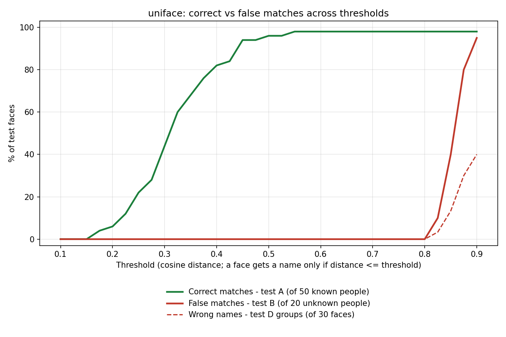

# Research: offline face recognition libraries

All tests: Windows 11, CPU only, Python 3.11.9, one separate virtual environment per library
(`experiments/envs/<library>/.venv`, not in git). Test data: LFW photos, built by `experiments/prepare_lfw.py`
(50 known people in `folder`, 50 new photos of them in `test_same`, 20 unknown people in `test_unknown`,
3 group photos with 10 faces each).

## 1. Smoke test of all 4 libraries

Each library got a short test: install, find faces and make embeddings on 3 images, time per image,
and run with the network blocked (dead proxy) to check it works offline.

| | DeepFace | face_recognition | InsightFace | UniFace |
|---|---|---|---|---|
| Install on Python 3.11 | OK, 114 s | **Failed**, 38 s | OK, 50 s | OK, 36 s |
| Install problems | 2 (see below) | dlib cannot be built: needs Visual C++ Build Tools | none | none |
| Detector + model used | retinaface + Facenet512 | not tested | SCRFD-10G + ArcFace (buffalo_l) | SCRFD-10G + ArcFace ResNet |
| Faces found (folder photo / test_same photo / group1) | 1 / 1 / 11 | not tested | 1 / 1 / 11 | 1 / 1 / 11 |
| Seconds per image (same 3 images) | 1.06 / 1.15 / 2.34 | not tested | 0.57 / 0.63 / 1.51 | 0.54 / 0.42 / 1.37 |
| Model load time (first call) | 10.4 s | not tested | 3.8 s | 1.9 s |
| Works fully offline after first download | yes | not tested | yes | yes |
| Model files | `~/.deepface` (204 MB) | not tested | `~/.insightface` (601 MB) | `~/.uniface` (183 MB) |
| Size of the environment | 2.0 GB | not tested | 509 MB | 475 MB |

Install problems we logged (full logs in `experiments/results/install_logs/`):

- **DeepFace**: (1) the first `import tensorflow` took about 53 s. (2) DeepFace prints an emoji in its log
  messages; on a normal Windows console this crashes it with `UnicodeEncodeError` when it downloads the
  first model. Fix: set `PYTHONUTF8=1`. Models are downloaded from GitHub on first use (Facenet512 95 MB,
  retinaface 119 MB). Our first test attempt hung for 10 minutes because of the crash. Cold first image
  took 8-14 s; later images 1-2 s.
- **face_recognition**: `pip install face_recognition` stops while building dlib from source. The error says
  "You must use Visual Studio to build a python extension on windows". Visual C++ Build Tools are not
  installed on this PC. We stopped there (time box) and did not try a workaround. Untried options: install
  the build tools (several GB) or use a third-party prebuilt dlib wheel.
- **InsightFace**: no problems. The first run downloads the buffalo_l pack (about 280 MB) from GitHub.
  A harmless scikit-image FutureWarning appears.
- **UniFace**: no problems. First run downloaded two models (16 MB and 166 MB), cold first call 158 s.

Note: UniFace's ArcFace weights and InsightFace's buffalo_l come from the same model family, so their
results are expected to be similar. What differs is the library itself (install, size, speed, API).
UniFace's own default models are lighter ones (RetinaFace MobileNet + EdgeFace); we picked the stronger ones.

## 2. Full evaluation: UniFace only

Setup: detector SCRFD-10G, embedding ArcFace ResNet (512 numbers per face), distance = cosine distance
(0 = identical, bigger = more different). Rule: find the nearest person in `folder`; if that distance is
at most the threshold the face gets that name, otherwise it is "Unknown". The threshold was swept from
0.10 to 0.90 in steps of 0.025.

Files in `experiments/results/`: `uniface_sweep.csv` (the full threshold table), `uniface_probes.csv` (nearest
person and distance for every single test face), `uniface_testC.csv`, `uniface_timing.csv`,
`uniface_threshold_chart.png`, `uniface_group1_annotated.jpg`. Re-run with
`experiments/envs/uniface/.venv/Scripts/python.exe experiments/evaluate.py wrap_uniface`, then
`python experiments/make_chart.py uniface`.

### Test C: faces found in the group photos (does not depend on the threshold)

| Photo | Faces found in total | Of the 10 expected faces found | Extra faces |
|---|---|---|---|
| group1 | 11 | 10 / 10 | 1 |
| group2 | 13 | 10 / 10 | 3 |
| group3 | 10 | 10 / 10 | 0 |

All 30 expected faces were found. The "extra" faces are not mistakes of the detector: the LFW photos
sometimes show other people in the background. In group1 we checked by eye: the 11th face is a real
person standing behind the man in position 8 (see `uniface_group1_annotated.jpg`). We did not look at the
extras in group2 yet. Extras are ignored in test D (we only judge the 10 positions) and they are listed
separately in the sweep table.

### Tests A, B, D across thresholds

Selected rows (full table in `uniface_sweep.csv`):

| Threshold | A: correct names (of 50) | A: wrong names | B: unknown people wrongly named (of 20) | D: correct names (of 18) | D: correct Unknown (of 12) | D: wrong names |
|---|---|---|---|---|---|---|
| 0.30 | 22 | 0 | 0 | 8 | 12 | 0 |
| 0.40 | 41 | 0 | 0 | 15 | 12 | 0 |
| 0.45 | 47 | 0 | 0 | 17 | 12 | 0 |
| 0.50 | 48 | 0 | 0 | 18 | 12 | 0 |
| 0.55 to 0.80 | 49 | 0 | 0 | 18 | 12 | 0 |
| 0.825 | 49 | 0 | 2 | 18 | 11 | 1 |
| 0.85 | 49 | 0 | 8 | 18 | 8 | 4 |
| 0.875 | 49 | 0 | 16 | 18 | 3 | 9 |
| 0.90 | 49 | 1 | 19 | 18 | 0 | 12 |

What the numbers say:

- Same-person distances (test A) are mostly small: median 0.31, 95% of them at or below 0.47.
- Distances from unknown people to their nearest stranger in the folder (test B) are all between 0.80 and 0.91.
- One person (Cristina Fernandez) is never matched correctly: her nearest folder person is a stranger at
  distance 0.90. She is the one missing correct name in test A, and with a threshold of 0.90 she gets a wrong name.
- From 0.50 upward every group-photo face (test D) is right: 18 correct names, 12 correct "Unknown", 0 wrong.

### Which threshold range looks sensible (your choice, not ours)

On this test set there is a wide flat zone: from **0.55 to 0.80** the results do not change at all
(49 of 50 recognised, no wrong names, no false matches). Below about 0.50 the library starts to say
"Unknown" for people it should know (at 0.40 we already miss 9 of 50). Above 0.80 strangers start getting names
very quickly (2, then 8, then 16 of 20 in just three steps).

Because the flat zone is wide, a value in the **middle** of it, roughly **0.60 to 0.70**, has room for error
on both sides. That matters because real photos are harder than this test (see limits): same-person
distances will grow and stranger distances will shrink, so the safe zone will get narrower. If a false name is
worse for you than a missed person, lean to the lower side; if missing a person is worse, lean to the upper side.
Please re-check the range on some of your own real photos before fixing a number.

### Speed (CPU, after warm-up, models already loaded)

Median 0.44 s per image over 123 images. Single face photos about 0.4-0.5 s, group photos (10 faces) about 1.4 s.
Model loading takes about 2 s once per run.

## 3. Limits of this test

- The group "photos" are collages: every face is large, sharp, frontal and cut out of a separate photo, and the
  lighting is the same for each face. Real group photos have small, blurred, turned, partly hidden faces, so
  detection (test C) and matching (test D) will be clearly harder.
- The same-person photos come from the same dataset (news photos, LFW), so folder and test photos are alike.
  Photos taken years apart, with glasses, masks or very different light will have larger distances.
- The set is small: 50 known people, 20 unknown, 30 group faces. One person is 2% in test A. Do not read small
  differences as real.
- Unknown people in test B and D were picked at random, not chosen to look like someone in the folder (no twins,
  relatives or same-sex-same-age lookalikes), so false matches are likely easier to avoid than in real life.
- Each person has exactly one reference photo in the folder. Several reference photos per person would help.
- Only UniFace was fully evaluated. DeepFace, InsightFace and face_recognition have only the smoke test above,
  so no accuracy comparison between libraries exists yet.
- Times are from one Windows PC (CPU only, no GPU). They are meant as a rough comparison only.
